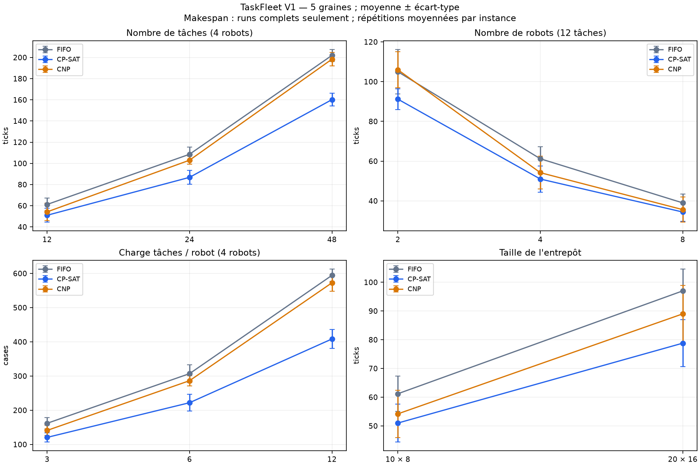
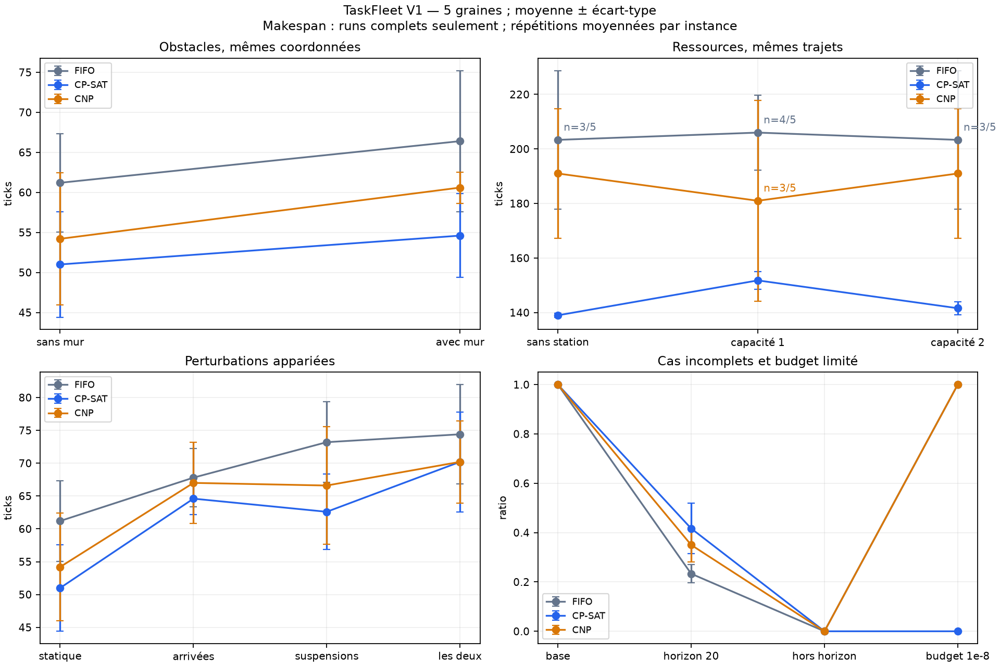
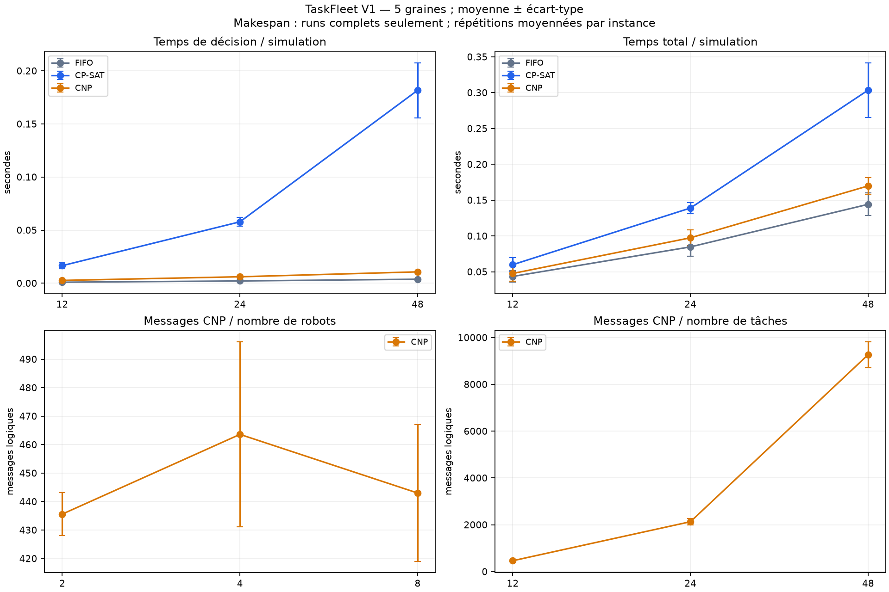

[English](benchmark.md) | [Français](benchmark.fr.md) | [简体中文](benchmark.zh-CN.md)

<a id="benchmark-et-métriques"></a>
# Benchmark and metrics


<a id="problème-et-stratégies"></a>
## Problem and strategies

Compare FIFO, CP-SAT and CNP for assigning collection/delivery tasks to robots, with capacities, obstacles, shared stations, and dynamic events. All three strategies use the same discrete engine, without knowledge of future tasks or unavailability.

- **FIFO** traverses tasks in order of `(arrival_tick, ID)` and selects the first compatible robot by ID. An incompatible task does not block subsequent tasks.
- **CP-SAT** maximizes the number of assignments, then minimizes their cost at proven cardinality: BFS distances to collection and destination plus two manipulations. Constraints enforce at most one task per robot and one robot per task. Deadlines and queues are ignored. `OPTIMAL` proves only this instantaneous subproblem; `FEASIBLE` remains a solution without proof of optimality. `UNKNOWN` is not a proof of infeasibility; a second phase with no solution preserves the feasible assignment from the first phase. `MODEL_INVALID` is an error.
- **CNP**: Each agent computes an offer from its robot, the grid, and the announced task. The first robot available by ID initiates the round; it selects `(offre reçue, ID)` and participates in the offers. Refusals, commitments, contracts, re-announcements, and returns are recorded. Synchronous local coordination, without a real distributed network or guaranteed collective optimum.

A movement covers one cell per tick, without diagonal movement. Each task requires a manipulation at both ends; deadlines allow late deliveries. Stations limit the number of robots in manipulation, independently of load. A suspension preserves the contract and reservation. Physical collisions are not simulated; queues follow the robot order without guarantee of fairness. Detailed conventions: [technical development log](memory.md#fonctionnement).

<a id="métriques"></a>
## Metrics

|Field|Definition and unit|
|---|---|
| `tasks_total`, `tasks_arrived`, `tasks_completed` |Total tasks, arrived at the final tick and actually delivered; tasks outside the horizon remain in the total|
| `completion_rate` |Delivered tasks / total tasks; ratio 1 with no task|
| `makespan` |Last delivery tick if all tasks are completed, otherwise `null`; 0 with no task|
| `total_tardiness` |Sum of `max(0, livraison − échéance)` for completed tasks, in ticks|
| `unfinished_tardiness_lower_bound` |Deadline bounds for arrived and incomplete tasks: sum of `max(0, tick final − échéance)`|
| `distance` |Number of cells traversed, counted since events `moved`|
| `mean_robot_utilization` |Average productive ticks / observed ticks by robot; movements and handling, excluding waits and suspensions; 0 with no robot or tick|
| `strategy_seconds`, `total_seconds` |Real-time duration of decisions and full computation, in seconds|
| `messages`, `invalid_decisions` |Logical messages and automatic proposals rejected by constraints|

Simulated time is in **ticks**; computation is measured by `perf_counter` in **seconds**. The engine continues ticks until the horizon, even after all deliveries. `strategy_seconds` excludes observations; `total_seconds` includes construction, simulation (decisions, observations, snapshots, invariants) and metric computation. Generation, warming-up, diagnostics, exports, and figures are excluded. Times vary.

`complete`, `incomplete` and `failed` distinguish completion, stop without all deliveries, and technical error. Incomplete runs contribute to the observed rates, distances, messages, and delays. Their makespan is never replaced by zero or the horizon: makespan averages are **conditional on completion**, with effective size `count`. A small completed delay may simply reflect fewer deliveries; also consult the incomplete tasks bound.

A broadcast announcement is counted once; each request and response is counted individually, including those from the initiator. Diagnostics separate `self_messages`, `direct_transmissions` (distinct agents) and `broadcasts`. Reference CNP: **1919 = 397 + 1132 + 390**. These counters do not measure packets, latency, or the cost of a physical network.

<a id="protocole-expérimental"></a>
## Experimental protocol

Measurements from **October 14, 2026**, seeds **11, 23, 37, 51, 79**, three strategies and **two deterministic repetitions**. Repetitions are averaged per instance before grain-level statistics: mean, sample standard deviation, median, min/max, and count. They do not constitute independent new observations. Control instances from the same seed are paired. Five observations per group, one only for `empty` and the complex reference; a zero or one observation with zero standard deviation does not establish stability.

Base: four robots, 12 tasks, grid 10 × 8, horizon 220, capacities 3, loads 1, 2-tick manipulations per end, and due dates `30 + 3i` for index i starting at 0. Variants preserve these parameters except for the factors below.

|Configurations|Factors studied|
|---|---|
| `small`, `base`, `tasks24`, `tasks48` |2 robots / 4 tasks / 6 × 4 / horizon 120 for `small`; 4 robots and 12/24/48 tasks for the others|
| `robots2`, `robots8`, `large_grid` |2 or 8 robots with the same tasks; grid 20 × 16 with regenerated positions|
| `obstacles`, `heterogeneous` |Vertical wall with central opening; variable loads/capacities with 24 tasks, control `tasks24`|
| `shared_free`, `shared1`, `shared2` |24 trajectories between two corners, 3-tick manipulations; no station or capacities 1/2|
| `arrivals`, `downtime`, `dynamic` |Batches of 3 tasks at ticks 0/15/30/45; suspensions `[8 + 3i, 20 + 3i)` for robots i = 0..3; combination of both|
| `short`, `late`, `empty` |Horizon 20; arrivals at tick 221 after horizon 220; no robot/task with horizon 0|
| `low_budget` |Identical instances `base` with reduced CP-SAT budget|

Generation draws a reservoir of 8 robots and 48 tasks per dimension/seed, then uses the necessary prefixes. Wall cells are excluded from drawing, including when removed in control instances: the distribution is synthetic. `heterogeneous` varies loads/capacities jointly; `large_grid` preserves the seed but regenerates coordinates. The complete parameters and each instance are in [report.json](results/v1/report.json).

**19 configurations generated**: 18 on five seeds, `empty` on one, plus `complex_comparison.json`: **18 × 5 + 1 + 1 = 92 scenarios**. The five `low_budget` reuse `base`: **92 − 5 = 87 distinct instances**. **92 × 3 × 2 = 552 simulations**, including **30 additional executions** (`5 × 3 × 2`) compared to `87 × 3 × 2 = 522`. The complex reference is already included.

Each strategy receives a new simulation of the same instance: robots, tasks, obstacles, stations, events, horizon, and footprint `instance_sha256` identical. Variants are paired with their control instance when applicable; `paired_differences` preserves the difference between strategy minus FIFO and variant minus control. A makespan difference requires two full runs.

CP-SAT: **OR-Tools 9.15.6755**, one worker, solver seed 0, **1 deterministic unit of time per phase**, except `low_budget` at **1e-8**. This budget is not in wall-clock seconds. Warm-up of the three strategies on `simple.json` is excluded from the counts. The statuses are preserved: **4096 phases OPTIMAL**, **2200 UNKNOWN**, only under stress; no FEASIBLE/INFEASIBLE/MODEL_INVALID observed. Stress produces no assignment here and retries at each tick; construction/BFS remain out of solver budget.

Times measured under Windows 11/Python 3.13.1, AMD64 Family 25 Model 97, without CPU isolation, with other validations ongoing and fixed order FIFO/CP-SAT/CNP. Two repetitions do not precisely characterize temporal noise. Fixed versions in [constraints.txt](../constraints.txt).

<a id="résultats"></a>
## Results

<a id="référence-complexe"></a>
### Reference complex

Grid 12 × 9, 14 obstacles, four robots, four stations, 18 tasks, horizon 200. A fixed instance, two repetitions per strategy, all complete and without invalid decisions.

|Metric|FIFO|CP-SAT|CNP|
|---|---:|---:|---:|
|Tasks completed| 18 | 18 | 18 |
|Makespan (ticks)| 154 | 114 | 142 |
|Final delay (ticks)| 437 | 179 | 365 |
|Distance (cells)| 340 | 279 | 312 |
|Logical messages| 0 | 0 | 1919 |

<a id="charge-avec-quatre-robots"></a>
### Load with four robots

Mean ± standard deviation across **five instances**, after averaging the two repetitions. All tasks complete within these groups; **n = 5** for each metric.

|Tasks|Makespan FIFO (ticks)|Makespan CP-SAT (ticks)|Makespan CNP (ticks)|
|---|---:|---:|---:|
| 12 | 61,2 ± 6,1 | 51,0 ± 6,6 | 54,2 ± 8,2 |
| 24 | 108,6 ± 6,7 | 86,8 ± 6,6 | 103,0 ± 3,8 |
| 48 | 202,0 ± 5,7 | 160,2 ± 6,1 | 198,4 ± 6,3 |

At 48 tasks, the other metrics show the trade-offs:

|Metric|FIFO|CP-SAT|CNP|
|---|---:|---:|---:|
|Final delay (ticks)| 533,8 ± 166,9 | 628,6 ± 138,6 | 368,8 ± 148,7 |
|Distance (cells)| 594,4 ± 18,2 | 408,4 ± 28,0 | 572,6 ± 24,3 |
|Decisions (ms)| 3,76 ± 0,29 | 181,73 ± 25,94 | 10,70 ± 0,52 |
|Total measured computation (ms)| 144,18 ± 15,91 | 303,50 ± 38,28 | 169,87 ± 11,67 |
|Logical messages| 0 | 0 | 9268,0 ± 546,8 |

<a id="complétion-et-cas-incomplets"></a>
### Completion and incomplete cases

**No technical error or invalid decision** across 552 simulations. The percentage below counts completed simulations, unlike `completion_rate` which counts tasks delivered in each simulation.

|Strategy|Simulations|Completed|Incomplete|Completed (%)|
|---|---:|---:|---:|---:|
|FIFO| 184 | 154 | 30 | 83,70 |
|CP-SAT| 184 | 154 | 30 | 83,70 |
|CNP| 184 | 160 | 24 | 86,96 |
|Total| 552 | 468 | 84 | 84,78 |

The **84 incomplete** cases include:

- **30 `short`**: horizon 20 too short; **30 `late`**: all arrivals outside the horizon.
- **10 CP-SAT `low_budget`**: no assignment obtained within the budget.
- **14 shared cases** at horizon 220: 4 FIFO `shared_free`, 4 FIFO `shared2`, 2 FIFO `shared1`, 4 CNP `shared1`, with long trajectories and, according to the scenario, station waits.

These cases remain within the other aggregates. Conditional workloads for makespans are listed in [summary.csv](results/v1/summary.csv) and the figures; no ranking can ignore a completion difference between strategies.

<a id="graphiques"></a>
### Graphs







Bars: standard deviations between instances, not confidence intervals. Only complete makespans are included, reduced workloads signaled by `n=x/5`; no physical interpolation between categories. Vector versions: [scaling.svg](results/v1/scaling.svg), [factors.svg](results/v1/factors.svg), [costs.svg](results/v1/costs.svg). The CSV files retain all metrics, dispersions, and workloads.

<a id="analyse"></a>
## Analysis

- **FIFO** completes all five instances of each load (12/24/48 tasks) with the lowest decision cost on this machine. It neither guarantees better delay nor completion of difficult cases. M5 also preserves scenarios with operationally identical results.
- **CP-SAT** reduces makespan on the five pairs of each load: **20.7%** on average at 48 tasks compared to FIFO, with less distance but more computation and completed delay. The objective ignores deadlines: a plausible explanation, without demonstrated causality. It loses to FIFO on two heterogeneous seeds; no general dominance.
- **CNP** can approach CP-SAT at eight robots or with combined perturbations, but does not dominate FIFO. Reannouncements, requests to all agents, and rejections explain the increase in messages with load: **463.6 / 2130.8 / 9268** for 12/24/48 tasks. Adding robots does not yield monotonic message growth: the number of rounds changes.
- **Load and perturbations**: more tasks or a larger grid increase makespans here; adding robots reduces makespans on each seed without stations. Walls and suspensions slow down on average; dynamic effects are not additive.
- **Stations**: queues and reallocations can modify completion in a non-monotonic way. CNP `shared1` completes **3/5 instances**, with conditional makespan **181 ticks**, compared to **191 ticks and 5/5** without stations: the lower mean does not demonstrate improvement. No strategy predicts queues; their exact causal effect is not isolated.

Five synthetic seeds and non-isolated times do not prove universal superiority, global dynamic optimality, or network efficiency. No global score or significance test. Collisions, battery, latency, transfers, and preemption are outside the model; traces of all ticks remain in memory. Stations and loads are not an industrial sample.

<a id="reproduction"></a>
## Reproduction

Installation and tests: [README](../README.md). From the root, PowerShell:

```powershell
.\.venv\Scripts\python.exe -m pip install -r requirements-benchmark.txt -c constraints.txt
.\.venv\Scripts\python.exe -m scripts.benchmark_extended --seeds 11 23 37 51 79 --repeats 2 --output "$env:TEMP/taskfleet-v1-a" --plots --compare docs/results/v1/report.json
.\.venv\Scripts\python.exe -m scripts.benchmark_extended --seeds 11 23 37 51 79 --repeats 2 --output "$env:TEMP/taskfleet-v1-b" --compare "$env:TEMP/taskfleet-v1-a/report.json"
```

Expected: **87 instances, 92 scenarios, 552 simulations, 468 complete, 84 incomplete**, `Deterministic comparison: True`, zero divergence, exit code 0. The previous final verification preserves instances, deterministic metrics, statuses, and trace fingerprints, intra-replication and inter-acquisition; aggregates and CSVs verified. Time and timestamps are excluded from equality. Reproduction at identical versions and platforms; CP-SAT can change between versions.

The script compares deterministic data, including `instance_sha256` and `trace_sha256`. Each scenario shares an imprint between strategies/runs; `low_budget` and `base` also share their imprint. The complete parameters are in the JSON, individual observations are in the CSV, and statistics between seeds are in the summary:

- [report.json](results/v1/report.json): protocol, instances, runs, aggregates, paired differences, and divergences.
- [runs.csv](results/v1/runs.csv): 552 executions; [summary.csv](results/v1/summary.csv): 60 groups.
- Three PNG/SVG figures above; the **nine reference exports** are preserved.

For M5: command from the [README](../README.md#utilisation), 36 complete runs with default examples and witnesses `:static`/`:arrivals`. Reference makespan/distance: `contention` 14 ticks/16 cases, `dynamic` 25/19 for the three strategies; `allocation` FIFO 6/8, CP-SAT/CNP 2/0. Without unavailability, `dynamic` yields 22/19; fully static, CP-SAT 18/15 versus FIFO/CNP 22/19. `simple` completes at tick 4 for the three. To isolate the complex reference:

```powershell
.\.venv\Scripts\python.exe -m taskfleet.benchmark examples/complex_comparison.json --repeats 2 --no-controls --json "$env:TEMP/taskfleet-complex.json"
```

Expected: six complete runs, metrics from the reference table. `--configurations` restricts the extension while preserving the complex reference; `--solver-budget` modifies the normal budget, without changing the stress `low_budget` to 1e-8. The comparison requires identical parameters.
