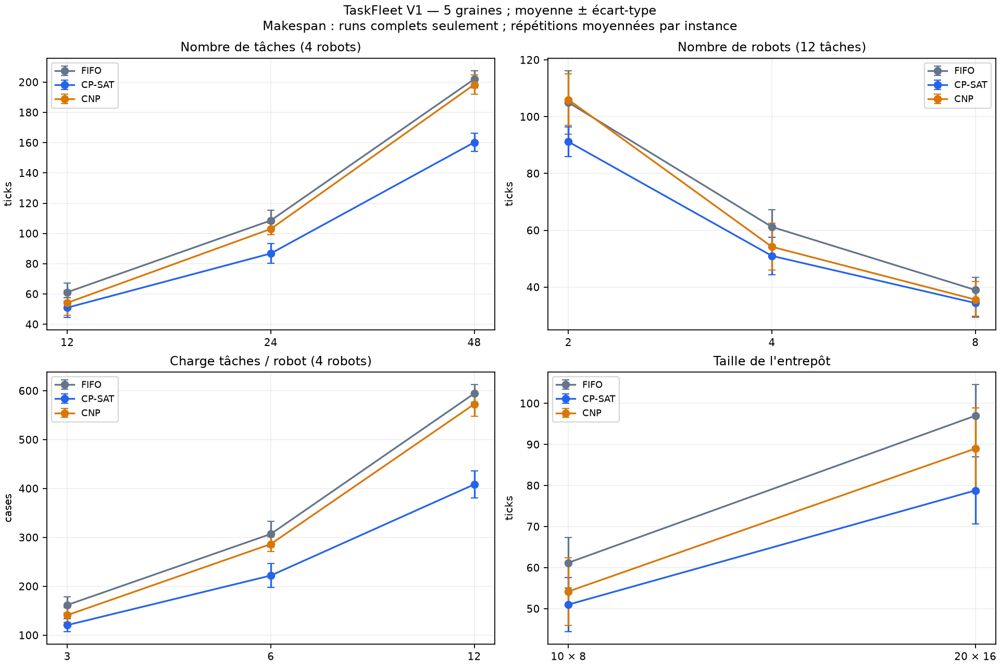
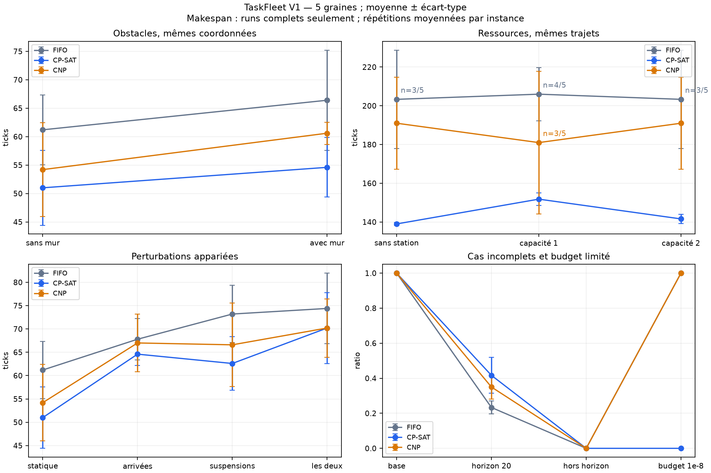
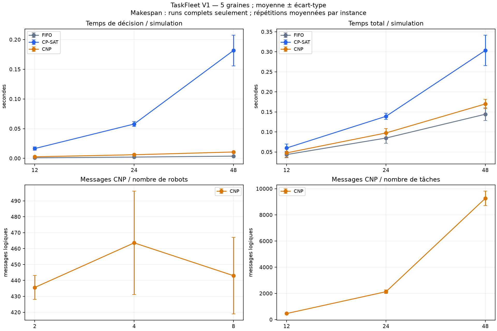

# Benchmark et métriques

## Problème et stratégies

Comparer FIFO, CP-SAT et CNP pour affecter des tâches de collecte/livraison à des robots,
avec capacités, obstacles, stations partagées et événements dynamiques. Les trois stratégies
utilisent le même moteur discret, sans connaissance des tâches ou indisponibilités futures.

- **FIFO** parcourt les tâches par `(arrival_tick, ID)` et choisit le premier robot
  compatible par ID. Une tâche incompatible ne bloque pas les suivantes.
- **CP-SAT** maximise le nombre d'affectations, puis minimise leur coût à cardinalité
  prouvée : distances BFS vers collecte et destination + deux manutentions. Les contraintes
  imposent au plus une tâche par robot et un robot par tâche. Échéances et files sont ignorées.
  `OPTIMAL` prouve seulement ce sous-problème instantané ; `FEASIBLE` reste une solution
  sans preuve d'optimum. `UNKNOWN` n'est pas une preuve d'infaisabilité ; une seconde phase
  sans solution conserve l'affectation faisable de première phase. `MODEL_INVALID` est une erreur.
- **CNP** : chaque agent calcule une offre depuis son robot, la grille et la tâche annoncée.
  Le premier robot disponible par ID initie le tour ; il choisit `(offre reçue, ID)` et
  participe aux offres. Refus, engagements, contrats, réannonces et retours sont tracés.
  Coordination synchrone locale, sans réseau distribué réel ni optimum collectif garanti.

Un déplacement couvre une case par tick, sans diagonale. Chaque tâche exige une manutention
à chaque extrémité ; les échéances autorisent les livraisons tardives. Les stations limitent
le nombre de robots en manutention, indépendamment de la charge. Une suspension conserve
contrat et réservation. Les collisions physiques ne sont pas simulées ; les files suivent
l'ordre des robots sans garantie d'équité. Conventions détaillées : [mémoire](memory.md#fonctionnement).

## Métriques

| Champ | Définition et unité |
|---|---|
| `tasks_total`, `tasks_arrived`, `tasks_completed` | Tâches totales, arrivées au tick final et réellement livrées ; les tâches hors horizon restent dans le total |
| `completion_rate` | Tâches livrées / tâches totales ; ratio 1 sans tâche |
| `makespan` | Dernier tick de livraison si toutes les tâches sont terminées, sinon `null` ; 0 sans tâche |
| `total_tardiness` | Somme `max(0, livraison − échéance)` des tâches achevées, en ticks |
| `unfinished_tardiness_lower_bound` | Borne des retards des tâches arrivées et inachevées : somme `max(0, tick final − échéance)` |
| `distance` | Nombre de cases parcourues, compté depuis les événements `moved` |
| `mean_robot_utilization` | Moyenne des ticks productifs / ticks observés par robot ; déplacements et manutentions, hors attentes et suspensions ; 0 sans robot ou tick |
| `strategy_seconds`, `total_seconds` | Temps réels des décisions et du calcul complet mesuré, en secondes |
| `messages`, `invalid_decisions` | Messages logiques et propositions automatiques rejetées par les contraintes |

Le temps simulé est en **ticks** ; le calcul est mesuré par `perf_counter` en **secondes**.
Le moteur poursuit les ticks jusqu'à l'horizon, même après toutes les livraisons.
`strategy_seconds` exclut les observations ; `total_seconds` comprend construction,
simulation (décisions, observations, snapshots, invariants) et calcul des métriques.
Génération, échauffement, diagnostics, exports et figures sont exclus. Les temps varient.

`complete`, `incomplete` et `failed` distinguent achèvement, arrêt sans toutes les livraisons
et erreur technique. Les runs incomplets contribuent aux taux, distances, messages et retards
observés. Leur makespan n'est jamais remplacé par zéro ou l'horizon : les moyennes de makespan
sont **conditionnelles à la complétion**, avec effectif `count`. Un retard achevé faible peut
simplement refléter moins de livraisons ; consulter aussi la borne des tâches incomplètes.

Une annonce broadcast compte une fois ; demandes et réponses comptent chacune, y compris
celles de l'initiateur. Les diagnostics séparent `self_messages`, `direct_transmissions`
(agents distincts) et `broadcasts`. Référence CNP : **1919 = 397 + 1132 + 390**.
Ces compteurs ne mesurent ni paquets, ni latence, ni coût d'un réseau physique.

## Protocole expérimental

Mesures du **14 octobre 2026**, graines **11, 23, 37, 51, 79**, trois stratégies et
**deux répétitions déterministes**. Les répétitions sont moyennées par instance avant les
statistiques entre graines : moyenne, écart-type d'échantillon, médiane, min/max et effectif.
Elles ne constituent pas de nouvelles observations indépendantes. Les témoins d'une même
graine sont appariés. Cinq observations par groupe, une seule pour `empty` et la référence
complexe ; un écart-type nul avec zéro ou une observation n'établit pas la stabilité.

Base : quatre robots, 12 tâches, grille 10 × 8, horizon 220, capacités 3, charges 1,
manutentions de 2 ticks par extrémité et échéances `30 + 3i` pour l'indice i commençant à 0.
Les variantes conservent ces paramètres sauf les facteurs ci-dessous.

| Configurations | Facteurs étudiés |
|---|---|
| `small`, `base`, `tasks24`, `tasks48` | 2 robots/4 tâches/6 × 4/horizon 120 pour `small` ; 4 robots et 12/24/48 tâches pour les autres |
| `robots2`, `robots8`, `large_grid` | 2 ou 8 robots avec les mêmes tâches ; grille 20 × 16 avec positions régénérées |
| `obstacles`, `heterogeneous` | Mur vertical à ouverture centrale ; charges/capacités variables avec 24 tâches, témoin `tasks24` |
| `shared_free`, `shared1`, `shared2` | 24 trajets entre deux coins, manutentions de 3 ticks ; sans station ou capacités 1/2 |
| `arrivals`, `downtime`, `dynamic` | Lots de 3 tâches aux ticks 0/15/30/45 ; suspensions `[8 + 3i, 20 + 3i)` pour les robots i = 0..3 ; combinaison des deux |
| `short`, `late`, `empty` | Horizon 20 ; arrivées au tick 221 après horizon 220 ; aucun robot/tâche avec horizon 0 |
| `low_budget` | Instances `base` identiques, budget CP-SAT réduit |

La génération tire un réservoir de 8 robots et 48 tâches par dimension/graine, puis utilise
les préfixes nécessaires. Les cases du mur sont exclues du tirage, y compris lorsqu'il est
retiré dans les témoins : la distribution est synthétique. `heterogeneous` varie conjointement
charges/capacités ; `large_grid` conserve la graine, mais régénère les coordonnées.
Les paramètres complets et chaque instance sont dans [report.json](results/v1/report.json).

**19 configurations générées** : 18 sur cinq graines, `empty` sur une seule, plus
`complex_comparison.json` : **18 × 5 + 1 + 1 = 92 scénarios**.
Les cinq `low_budget` réutilisent `base` : **92 − 5 = 87 instances distinctes**.
**92 × 3 × 2 = 552 simulations**, soit les **30 exécutions** supplémentaires
(`5 × 3 × 2`) par rapport à `87 × 3 × 2 = 522`. La référence complexe est déjà incluse.

Chaque stratégie reçoit une simulation neuve de la même instance : robots, tâches,
obstacles, stations, événements, horizon et empreinte `instance_sha256` identiques.
Les variantes sont appariées à leur témoin quand applicable ; `paired_differences`
conserve les écarts stratégie moins FIFO et variante moins témoin. Une différence de
makespan exige deux runs complets.

CP-SAT : **OR-Tools 9.15.6755**, un worker, graine solveur 0, **1 unité de temps
déterministe par phase**, sauf `low_budget` à **1e-8**. Ce budget n'est pas en secondes
murales. Échauffement des trois stratégies sur `simple.json`, exclu des comptes.
Les statuts sont conservés : **4096 phases OPTIMAL**, **2200 UNKNOWN**, uniquement sous
stress ; aucun FEASIBLE/INFEASIBLE/MODEL_INVALID observé. Le stress ne produit aucune
affectation ici et réessaie à chaque tick ; construction/BFS restent hors budget solveur.

Temps mesurés sous Windows 11/Python 3.13.1, AMD64 Family 25 Model 97, sans isolation CPU,
avec d'autres validations en cours et ordre fixe FIFO/CP-SAT/CNP. Deux répétitions ne
caractérisent pas précisément le bruit temporel. Versions fixées dans [constraints.txt](../constraints.txt).

## Résultats

### Référence complexe

Grille 12 × 9, 14 obstacles, quatre robots, quatre stations, 18 tâches, horizon 200.
Une instance fixe, deux répétitions par stratégie, toutes complètes et sans décision invalide.

| Métrique | FIFO | CP-SAT | CNP |
|---|---:|---:|---:|
| Tâches livrées | 18 | 18 | 18 |
| Makespan (ticks) | 154 | 114 | 142 |
| Retard achevé (ticks) | 437 | 179 | 365 |
| Distance (cases) | 340 | 279 | 312 |
| Messages logiques | 0 | 0 | 1919 |

### Charge avec quatre robots

Moyenne ± écart-type entre **cinq instances**, après moyenne des deux répétitions.
Toutes les tâches terminent dans ces groupes ; **n = 5** pour chaque métrique.

| Tâches | Makespan FIFO (ticks) | Makespan CP-SAT (ticks) | Makespan CNP (ticks) |
|---|---:|---:|---:|
| 12 | 61,2 ± 6,1 | 51,0 ± 6,6 | 54,2 ± 8,2 |
| 24 | 108,6 ± 6,7 | 86,8 ± 6,6 | 103,0 ± 3,8 |
| 48 | 202,0 ± 5,7 | 160,2 ± 6,1 | 198,4 ± 6,3 |

À 48 tâches, les autres métriques montrent les compromis :

| Métrique | FIFO | CP-SAT | CNP |
|---|---:|---:|---:|
| Retard achevé (ticks) | 533,8 ± 166,9 | 628,6 ± 138,6 | 368,8 ± 148,7 |
| Distance (cases) | 594,4 ± 18,2 | 408,4 ± 28,0 | 572,6 ± 24,3 |
| Décisions (ms) | 3,76 ± 0,29 | 181,73 ± 25,94 | 10,70 ± 0,52 |
| Calcul total mesuré (ms) | 144,18 ± 15,91 | 303,50 ± 38,28 | 169,87 ± 11,67 |
| Messages logiques | 0 | 0 | 9268,0 ± 546,8 |

### Complétion et cas incomplets

**Aucune erreur technique ni décision invalide** sur les 552 simulations.
Le pourcentage ci-dessous compte les simulations achevées, contrairement à `completion_rate`
qui compte les tâches livrées dans chaque simulation.

| Stratégie | Simulations | Complètes | Incomplètes | Complètes (%) |
|---|---:|---:|---:|---:|
| FIFO | 184 | 154 | 30 | 83,70 |
| CP-SAT | 184 | 154 | 30 | 83,70 |
| CNP | 184 | 160 | 24 | 86,96 |
| Total | 552 | 468 | 84 | 84,78 |

Les **84 incomplètes** comprennent :

- **30 `short`** : horizon 20 trop court ; **30 `late`** : toutes les arrivées hors horizon.
- **10 CP-SAT `low_budget`** : aucune affectation obtenue dans le budget.
- **14 cas partagés** à horizon 220 : 4 FIFO `shared_free`, 4 FIFO `shared2`,
  2 FIFO `shared1`, 4 CNP `shared1`, avec trajets longs et, selon le scénario, attentes de station.

Ces cas restent dans les autres agrégats. Les effectifs conditionnels des makespans figurent
dans [summary.csv](results/v1/summary.csv) et les figures ; aucun classement ne peut ignorer
une différence de complétion entre stratégies.

### Graphiques







Barres : écarts-types entre instances, pas intervalles de confiance. Makespans complets
seulement, effectifs réduits signalés par `n=x/5` ; aucune interpolation physique entre catégories.
Versions vectorielles : [scaling.svg](results/v1/scaling.svg), [factors.svg](results/v1/factors.svg),
[costs.svg](results/v1/costs.svg). Les CSV conservent toutes les métriques, dispersions et effectifs.

## Analyse

- **FIFO** termine les cinq instances de chaque charge 12/24/48 tâches avec le coût de
  décision le plus faible sur cette machine. Il ne garantit ni meilleur délai, ni achèvement
  des cas difficiles. M5 conserve aussi des scénarios aux résultats opérationnels identiques.
- **CP-SAT** réduit le makespan sur les cinq paires de chaque charge : **20,7 %** en moyenne
  à 48 tâches contre FIFO, avec moins de distance mais davantage de calcul et de retard achevé.
  L'objectif ignore les échéances : explication plausible, sans ablation démontrant la cause.
  Il perd contre FIFO sur deux graines hétérogènes ; aucune dominance générale.
- **CNP** peut se rapprocher de CP-SAT à huit robots ou avec perturbations combinées, mais
  ne domine pas FIFO. Les réannonces, demandes à tous les agents et refus expliquent la hausse
  des messages avec la charge : **463,6 / 2130,8 / 9268** pour 12/24/48 tâches.
  Ajouter des robots ne donne pas une croissance monotone des messages : le nombre de tours change.
- **Charge et perturbations** : plus de tâches ou une grille plus grande accroissent ici
  les makespans ; ajouter des robots les réduit sur chaque graine sans station. Mur et
  suspensions ralentissent en moyenne ; les effets dynamiques ne sont pas additifs.
- **Stations** : files et réallocations peuvent modifier la complétion de façon non monotone.
  CNP `shared1` termine **3/5 instances**, avec makespan conditionnel **181 ticks**, contre
  **191 ticks et 5/5** sans station : la moyenne inférieure ne démontre pas une amélioration.
  Aucune stratégie ne prédit les files ; leur effet causal exact n'est pas isolé.

Cinq graines synthétiques et des temps non isolés ne prouvent ni supériorité universelle,
ni optimalité dynamique globale, ni efficacité réseau. Aucun score global ou test de
significativité. Collisions, batterie, latence, transferts et préemption sont hors modèle ;
les traces de tous les ticks restent en mémoire. Les stations/charges ne sont pas un échantillon industriel.

## Reproduction

Installation et tests : [README](../README.md). Depuis la racine, PowerShell :

```powershell
.\.venv\Scripts\python.exe -m pip install -r requirements-benchmark.txt -c constraints.txt
.\.venv\Scripts\python.exe -m scripts.benchmark_extended --seeds 11 23 37 51 79 --repeats 2 --output "$env:TEMP/taskfleet-v1-a" --plots --compare docs/results/v1/report.json
.\.venv\Scripts\python.exe -m scripts.benchmark_extended --seeds 11 23 37 51 79 --repeats 2 --output "$env:TEMP/taskfleet-v1-b" --compare "$env:TEMP/taskfleet-v1-a/report.json"
```

Attendu : **87 instances, 92 scénarios, 552 simulations, 468 complètes, 84 incomplètes**,
`Deterministic comparison: True`, zéro divergence, code de sortie 0. La vérification finale
précédente conserve instances, métriques déterministes, statuts et empreintes des traces,
intra-répétitions et entre acquisitions ; agrégats et CSV vérifiés. Temps et horodatages exclus
de l'égalité. Reproduction à versions et plateforme identiques ; CP-SAT peut changer entre versions.

Le script compare les données déterministes, y compris `instance_sha256` et `trace_sha256`.
Chaque scénario partage une empreinte entre stratégies/répétitions ; `low_budget` et `base`
partagent aussi leur empreinte. Les paramètres complets sont dans le JSON, les observations
individuelles dans le CSV et les statistiques entre graines dans le résumé :

- [report.json](results/v1/report.json) : protocole, instances, runs, agrégats, écarts appariés et divergences.
- [runs.csv](results/v1/runs.csv) : 552 exécutions ; [summary.csv](results/v1/summary.csv) : 60 groupes.
- Trois figures PNG/SVG ci-dessus ; les **neuf exports de référence** sont conservés.

Pour M5 : commande du [README](../README.md#utilisation), 36 exécutions complètes avec les
exemples par défaut et témoins `:static`/`:arrivals`. Références makespan/distance :
`contention` 14 ticks/16 cases, `dynamic` 25/19 pour les trois stratégies ; `allocation`
FIFO 6/8, CP-SAT/CNP 2/0. Sans indisponibilité, `dynamic` donne 22/19 ; entièrement
statique, CP-SAT 18/15 contre FIFO/CNP 22/19. `simple` termine au tick 4 pour les trois.
Pour isoler la référence complexe :

```powershell
.\.venv\Scripts\python.exe -m taskfleet.benchmark examples/complex_comparison.json --repeats 2 --no-controls --json "$env:TEMP/taskfleet-complex.json"
```

Attendu : six runs complets, métriques du tableau de référence. `--configurations` restreint
l'extension en gardant la référence complexe ; `--solver-budget` modifie le budget normal,
sans changer le stress `low_budget` à 1e-8. La comparaison exige les mêmes paramètres.
