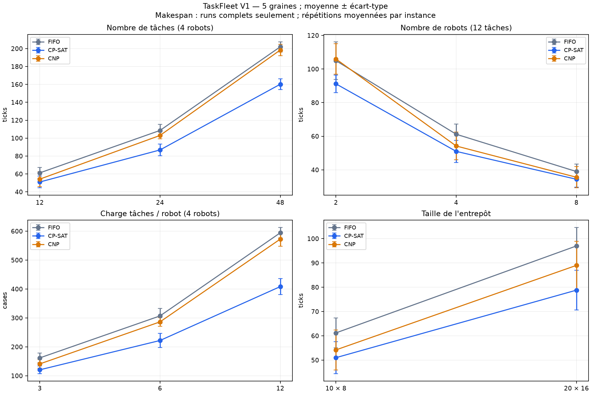
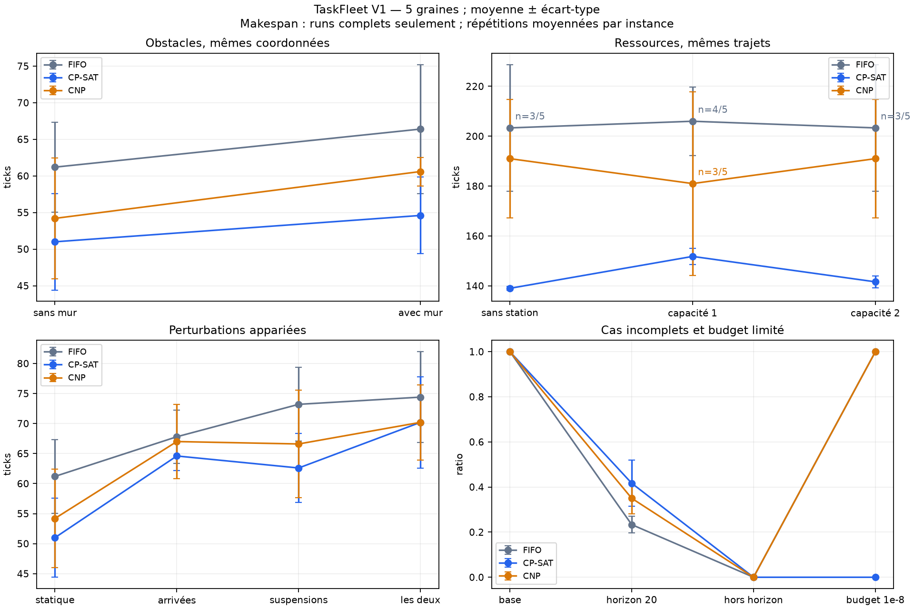
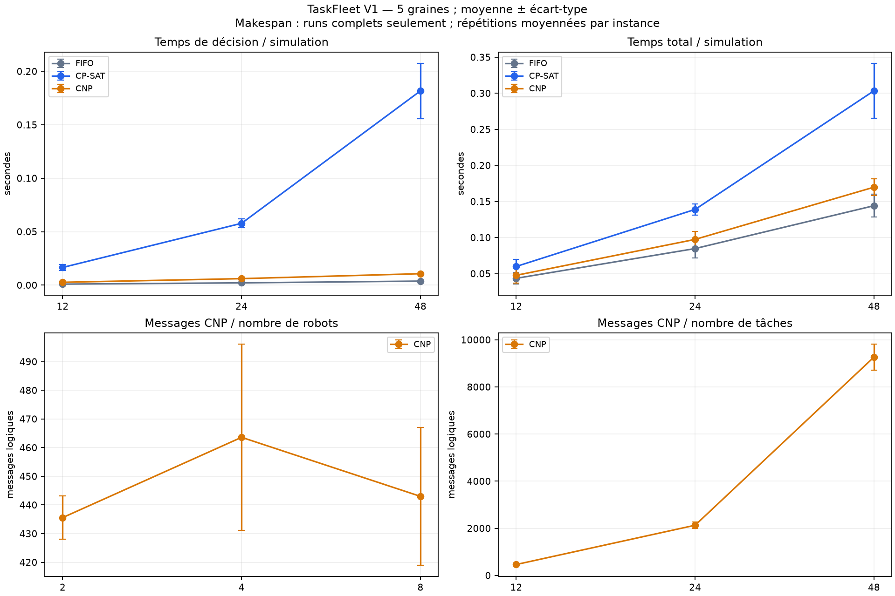

[English](benchmark.md) | [Français](benchmark.fr.md) | [简体中文](benchmark.zh-CN.md)

<a id="benchmark-et-métriques"></a>
# 基准与度量标准

<a id="problème-et-stratégies"></a>
## 问题与策略

比较FIFO、CP-SAT和CNP策略，为收集/配送任务分配机器人，考虑容量、障碍物、共享站点和动态事件。三种策略使用相同的离散求解器，且不预知任务或未来不可用情况。

- **FIFO** 按`(arrival_tick, ID)`顺序遍历任务，并选择ID最小的首个兼容机器人。一个不兼容的任务不会阻塞后续任务。
- **CP-SAT** 最大化分配数量，随后最小化其成本（已证明的基数成本）：从收集点到目的地的BFS距离加上两次搬运成本。约束条件确保每个机器人最多承担一个任务，每个任务仅由一个机器人承担。截止时间与队列被忽略。`OPTIMAL`仅证明了该瞬时子问题；`FEASIBLE`仍为无最优性证明的解。`UNKNOWN`并非不可行性的证明；若第二阶段无解，则保留第一阶段的可行分配。`MODEL_INVALID`为错误。
- **CNP**：每个代理基于其机器人、网格和已宣布的任务计算出报价。按ID顺序首个可用机器人发起一轮；它选择`(offre reçue, ID)`并参与报价。拒绝、承诺、合同、重新发布和回退均被记录。采用本地同步协调，无真实分布式网络，也无集体最优性保障。

移动操作每tick覆盖一个格子，不包含对角线。每个任务在两端均需搬运操作；截止时间允许延迟交付。站点限制在搬运状态下的机器人数量，与负载无关。暂停操作保留合同与预订。物理碰撞未被模拟；队列遵循机器人顺序，但无公平性保障。详细约定见：[内存](memory.zh-CN.md#fonctionnement)。

<a id="métriques"></a>
## 度量标准

|领域|定义与单位|
|---|---|
| `tasks_total`, `tasks_arrived`, `tasks_completed` |任务总数、最终tick到达的任务以及实际交付的任务；超出时间范围的任务仍计入总数|
| `completion_rate` |交付任务数 / 总任务数；当无任务时比值为1|
| `makespan` |若所有任务均完成，则为最后交付tick，否则为`null`；若无任务则为0|
| `total_tardiness` |已完成任务的`max(0, livraison − échéance)`之和（以tick为单位）|
| `unfinished_tardiness_lower_bound` |到达和未完成任务的延迟上限：`max(0, tick final − échéance)`之和|
| `distance` |已遍历的格子数量，从`moved`事件开始计数|
| `mean_robot_utilization` |每个机器人的有效tick数/观察tick数的平均值；包含移动与搬运操作，不包含等待与暂停；若无机器人或tick则为0|
| `strategy_seconds`, `total_seconds` |决策与完整计算过程的实时时间，单位为秒|
| `messages`, `invalid_decisions` |被约束条件拒绝的逻辑消息与自动提案数量|

模拟时间以**tick**为单位；计算过程以`perf_counter`为单位，以**秒**计。求解器持续推进tick直至时间边界，即使所有交付已完成。`strategy_seconds`排除观察数据；`total_seconds`包含构建、模拟（决策、观察、快照、不变量）及度量计算。生成、预热、诊断、导出与图表均被排除。时间会随情况变化。

`complete`、`incomplete` 和 `failed` 区分完成、未完成所有交付的停止以及技术错误。未完成的运行会贡献到观察到的速率、距离、消息和延迟中。它们的 makespan 从未被替换为零或时间范围：makespan 的平均值是**以完成为条件的**，有效数量为 `count`。一个轻微的已完成延迟可能仅反映交付数量较少；请同时参考未完成任务的上限。

广播通知仅计一次；请求和响应各自计一次，包括发起方的。诊断将 `self_messages`、`direct_transmissions`（独立的代理）和 `broadcasts` 分开。参考 CNP：**1919 = 397 + 1132 + 390**。这些计数器不测量数据包、延迟或物理网络的成本。

<a id="protocole-expérimental"></a>
## 实验协议

测量日期为 **2026年10月14日**，种子值为 **11、23、37、51、79**，三种策略和**两次确定性重复**。重复在各种子实例之间进行平均，再用于统计：均值、样本标准差、中位数、最小/最大值和有效数量。这些重复不构成独立的新观测。同一种子的见证者被配对。每组五次观测，`empty` 和复杂参考仅一次；标准差为零或仅一次观测，并不能说明稳定性。

基础设置：四个机器人，12 个任务，10×8 网格，时间范围 220，容量为 3，负载为 1，两端操作耗时 2 个时间步，任务 i（从 0 开始）的截止时间为 `30 + 3i`。变体保留这些参数，仅在以下因素上有所变化。

|配置|研究因素|
|---|---|
| `small`, `base`, `tasks24`, `tasks48` |`small` 的配置为：2 个机器人/4 个任务/6×4/时间范围 120；其他情况为 4 个机器人和 12/24/48 个任务|
| `robots2`, `robots8`, `large_grid` |2 或 8 个机器人，使用相同任务；网格为 20×16，位置重新生成|
| `obstacles`, `heterogeneous` |垂直墙带中心开口；负载/容量可变，共 24 个任务，见证者为 `tasks24`|
| `shared_free`, `shared1`, `shared2` |两个角落之间有 24 条路径，操作耗时为 3 个时间步；无站点或容量为 1/2|
| `arrivals`, `downtime`, `dynamic` |在时间步 0/15/30/45 时有 3 个任务的批次；机器人 i = 0..3 的暂停为 `[8 + 3i, 20 + 3i)`；组合两种情况|
| `short`, `late`, `empty` |时间范围为 20；在时间步 221 到达，超出时间范围 220；没有任何机器人或任务的时间范围为 0|
| `low_budget` |`base` 的实例完全相同，CP-SAT 预算减少|

生成过程从每个维度/种子中抽取 8 个机器人和 48 个任务作为储备，然后使用必要的前缀。墙的格子在抽取时被排除，即使在见证者中移除时也是如此：分布是合成的。`heterogeneous` 联合变化负载/容量；`large_grid` 保持种子不变，但重新生成坐标。完整的参数和每个实例均在 [report.json](results/v1/report.json) 中。

**生成了 19 种配置**：5 个种子中 18 种，`empty` 为 1 种，加上 `complex_comparison.json`：**18 × 5 + 1 + 1 = 92 种场景**。五个 `low_budget` 重用 `base`：**92 − 5 = 87 个独立实例**。**92 × 3 × 2 = 552 次模拟**，即比 `87 × 3 × 2 = 522` 多出的**30 次额外执行**（`5 × 3 × 2`）。复杂参考已包含在内。

每个策略都接收同一实例的新模拟：机器人、任务、障碍物、站点、事件、时间范围和印迹 `instance_sha256` 完全相同。当适用时，变体会与它们的对照组配对；`paired_differences` 保留策略比 FIFO 和变体比对照组的差异。如果 makespan 存在差异，则需要两次完整运行。

CP-SAT：**OR-Tools 9.15.6755**，一个工作进程，求解器种子为 0，**每阶段 1 个确定性时间单位**，除非 `low_budget` 为 **1e-8**。此预算并非以壁钟秒为单位。在 `simple.json` 上对三种策略进行预热，不计入统计。状态保持不变：**4096 个阶段为 OPTIMAL**，**2200 个 UNKNOWN**，仅在压力测试下；未观察到任何 FEASIBLE/INFEASIBLE/MODEL_INVALID。压力测试在此不产生任何分配，并在每个 tick 重新尝试；构造/BFS 仍超出求解器预算。

在 Windows 11/Python 3.13.1、AMD64 Family 25 Model 97 上测量，未启用 CPU 隔离，其他验证正在进行中，顺序为固定 FIFO/CP-SAT/CNP。两次重复无法精确表征时间噪声。版本信息见 [constraints.txt](../constraints.txt)。

<a id="résultats"></a>
## 结果

<a id="référence-complexe"></a>
### 参考复杂度

12×9 网格，14 个障碍物，4 个机器人，4 个站点，18 个任务，时间范围为 200。一个固定实例，每策略进行两次重复，所有运行均完整且无无效决策。

|指标|FIFO|CP-SAT|CNP|
|---|---:|---:|---:|
|完成的任务| 18 | 18 | 18 |
|makespan（tick）| 154 | 114 | 142 |
|完成延迟（tick）| 437 | 179 | 365 |
|距离（格子）| 340 | 279 | 312 |
|逻辑消息| 0 | 0 | 1919 |

<a id="charge-avec-quatre-robots"></a>
### 四机器人负载

基于 **五次实例** 的平均值 ± 标准差，经过两次重复的平均处理。所有任务均在这些组中完成；**n = 5** 对每个指标。

|任务|FIFO makespan（tick）|CP-SAT makespan（tick）|CNP makespan（tick）|
|---|---:|---:|---:|
| 12 | 61,2 ± 6,1 | 51,0 ± 6,6 | 54,2 ± 8,2 |
| 24 | 108,6 ± 6,7 | 86,8 ± 6,6 | 103,0 ± 3,8 |
| 48 | 202,0 ± 5,7 | 160,2 ± 6,1 | 198,4 ± 6,3 |

在 48 个任务时，其他指标显示了权衡：

|指标|FIFO|CP-SAT|CNP|
|---|---:|---:|---:|
|完成延迟（tick）| 533,8 ± 166,9 | 628,6 ± 138,6 | 368,8 ± 148,7 |
|距离（格子）| 594,4 ± 18,2 | 408,4 ± 28,0 | 572,6 ± 24,3 |
|决策（ms）| 3,76 ± 0,29 | 181,73 ± 25,94 | 10,70 ± 0,52 |
|总计算时间（ms）| 144,18 ± 15,91 | 303,50 ± 38,28 | 169,87 ± 11,67 |
|逻辑消息| 0 | 0 | 9268,0 ± 546,8 |

<a id="complétion-et-cas-incomplets"></a>
### 完成与不完整情况

**在 552 次模拟中未发现任何技术错误或无效决策**。以下百分比统计的是已完成的模拟，与 `completion_rate` 统计每次模拟中完成的任务数量不同。

|策略|模拟次数|完整|不完整|完整（%）|
|---|---:|---:|---:|---:|
|FIFO| 184 | 154 | 30 | 83,70 |
|CP-SAT| 184 | 154 | 30 | 83,70 |
|CNP| 184 | 160 | 24 | 86,96 |
|总计| 552 | 468 | 84 | 84,78 |

这 **84 次不完整** 情况包括：

- **30 `short`**：时间范围 20 太短；**30 `late`**：所有到达均超出时间范围。
- **10 CP-SAT `low_budget`**：在预算内未获得任何分配。
- **14 个共享案例** 到 220 时点：4 个 FIFO `shared_free`，4 个 FIFO `shared2`，2 个 FIFO `shared1`，4 个 CNP `shared1`，具有较长路径，并且根据场景存在站点等待情况。

这些案例仍保留在其他聚合组中。各方案的makespan条件数量在 [summary.csv](results/v1/summary.csv) 和图表中列出；任何排序都不得忽略不同策略之间的完成差异。

<a id="graphiques"></a>
### 图表







条形图：展示实例间的标准差，而非置信区间。仅展示完整makespan，且`n=x/5`已标记有效样本数量；各类别间无物理插值。向量版本：[scaling.svg](results/v1/scaling.svg)，[factors.svg](results/v1/factors.svg)，[costs.svg](results/v1/costs.svg)。CSV文件保留所有指标、分散度和样本数量。

<a id="analyse"></a>
## 分析

- **FIFO** 在每种负载（12/24/48 个任务）的五个实例中，以该机器决策成本最低完成所有任务。它既不保证更优的延迟，也不确保完成困难案例。M5 也保留了若干操作结果相同的场景。
- **CP-SAT** 在每种负载的五对实例中均缩短了 makespan：在 48 个任务时，相对 FIFO 平均减少 **20.7%**，行驶距离较少，但计算开销和已完成任务的迟延更高。目标函数未考虑截止日期，这可作为一种合理解释，但尚无消融实验验证因果关系。它在两个异构种子的实例上逊于 FIFO；不存在普遍占优。
- **CNP** 在八台机器人或组合扰动下可接近CP-SAT，但并未超越FIFO。重发布、向所有代理请求及拒绝解释了负载下消息数量的上升：12/24/48 任务分别对应 **463.6 / 2130.8 / 9268**。增加机器人并未带来消息数量的单调增长：巡游次数发生了变化。
- **负载与扰动**：任务数量增加或网格尺寸增大均导致makespan上升；在无站点情况下，增加机器人可降低每种子的makespan。墙壁和悬挂结构平均会减缓进度；动态效应并非可叠加。
- **站点**：队列和重新分配可能以非单调方式改变完成情况。CNP `shared1` 完成 **3/5 个实例**，其条件makespan为 **181 个周期**，而无站点情况下为 **191 个周期和 5/5 个实例**：平均值较低并不表示性能提升。没有任何策略能预测队列行为；其确切因果效应尚未被隔离。

五组合成种子和非隔离时间无法证明普遍优越性、全局动态最优性或网络效率。不存在全局评分或显著性检验。碰撞、电池、延迟、传输和抢占均未纳入模型；所有周期的轨迹仍保留在内存中。站点/负载并非工业样本。

<a id="reproduction"></a>
## 可重复性

安装与测试：[README](../README.zh-CN.md)。从根目录开始，PowerShell 命令如下：

```powershell
.\.venv\Scripts\python.exe -m pip install -r requirements-benchmark.txt -c constraints.txt
.\.venv\Scripts\python.exe -m scripts.benchmark_extended --seeds 11 23 37 51 79 --repeats 2 --output "$env:TEMP/taskfleet-v1-a" --plots --compare docs/results/v1/report.json
.\.venv\Scripts\python.exe -m scripts.benchmark_extended --seeds 11 23 37 51 79 --repeats 2 --output "$env:TEMP/taskfleet-v1-b" --compare "$env:TEMP/taskfleet-v1-a/report.json"
```

预期结果：**87 个实例，92 个场景，552 次模拟，468 次完整，84 次不完整**，`Deterministic comparison: True`，零差异，退出码为 0。上一次最终验证保留了实例、确定性指标、状态和轨迹指纹，包括重复运行内和不同采集间的轨迹；聚合数据和CSV文件均已验证。时间与时间戳被排除在等值性之外。可重复性在版本和平台一致的前提下实现；CP-SAT 在不同版本间可能发生变化。

脚本比较了确定性数据，包括 `instance_sha256` 和 `trace_sha256`。每个场景在策略/重复之间共享一个指纹；`low_budget` 和 `base` 也共享它们的指纹。完整参数在 JSON 中，个体观察结果在 CSV 中，种子之间的统计信息在摘要中：

- [report.json](results/v1/report.json)：协议、实例、运行次数、聚合结果、配对偏差和差异。
- [runs.csv](results/v1/runs.csv)：552 次运行；[summary.csv](results/v1/summary.csv)：60 个组。
- 上方有三张 PNG/SVG 图表；**九个参考导出**被保留。

对于 M5：参考 [README](../README.zh-CN.md#utilisation)，36 次完整运行，使用默认示例和见证者 `:static`/`:arrivals`。参考的 makespan/距离：`contention` 14 个时钟/16 个案例，`dynamic` 25/19 对于三种策略；`allocation` FIFO 6/8，CP-SAT/CNP 2/0。在无不可用情况下，`dynamic` 得到 22/19；完全静态情况下，CP-SAT 18/15 对比 FIFO/CNP 22/19。`simple` 在三个场景中均在第 4 个时钟结束。为了隔离复杂参考场景：

```powershell
.\.venv\Scripts\python.exe -m taskfleet.benchmark examples/complex_comparison.json --repeats 2 --no-controls --json "$env:TEMP/taskfleet-complex.json"
```

预期：六次完整运行，参考表格的度量。`--configurations` 限制扩展，保留复杂参考；`--solver-budget` 修改正常预算，不改变压力 `low_budget` 保持在 1e-8。比较需要相同的参数。
